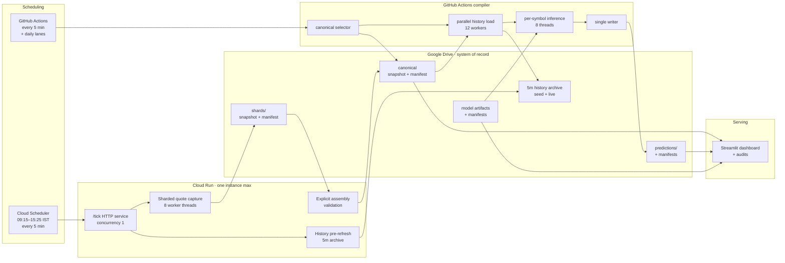

# Project Architecture — NSE Prediction System

| | |
|---|---|
| **Repository** | `andromyth/indian-market-trading` |
| **Document status** | Living architecture reference |
| **Last verified against code** | 2026-11-13 (`main` @ `6ce5ad0`) |

This document explains how the project works end to end: the prediction model,
the five-minute market-data pipeline, the daily Delivery lane, the storage
contracts, the runtime topology, and the operational safeguards. The code is
the final authority; this document is the map.

---

## 1. What the system is

An NSE cash-equity decision-support and prediction system. It:

- captures only the fixed 500-symbol owner-selected roster during market hours;
- builds point-in-time features from official EOD, delivery, F&O, news and
  five-minute intraday data;
- runs pooled machine-learning models for **30-minute intraday** and
  **next-session Delivery** horizons;
- persists every prediction together with the actual observed price so it can
  be evaluated later;
- continuously validates predictions, learns calibration overlays, and audits
  data quality;
- **never places orders.** There is no order-placement code in the repository.

The primary production product is the **five-minute selected-500 intraday
prediction and actual-price capture pipeline**. The daily Delivery pipeline is
a second, slower lane that shares the same Drive storage and governance
principles.

---

## 2. Design invariants

These rules explain most of the architecture. Any change that violates them is
a regression, even if it looks simpler.

1. **One INDstocks token owner.** Only the single Cloud Run acquisition
   process may authenticate to INDstocks. GitHub Actions and Streamlit never
   call INDstocks for production capture. Cloud Run uses TOTP credentials from
   Secret Manager; manual tokens are not accepted for deployment.
2. **No fabricated market data.** A live quote supplies the observed price.
   It does not establish current-slot open/high/low. Unavailable OHLC fields
   remain null; volume is only used when the provider supplies it.
3. **Shards are not snapshots.** A shard artifact can never be published or
   consumed as a complete slot. Only the explicit assembly step may write a
   canonical snapshot, and only after every shard validates.
4. **Fail closed on completeness, fail open on per-symbol coverage.**
   A missing or invalid shard blocks the whole canonical snapshot. A missing
   quote for one symbol does not block other symbols from being predicted.
5. **One authoritative prediction writer.** The compiler has parallel
   inference but a single writer. It reads only canonical Drive snapshots and
   rejects shard artifacts, incomplete assemblies, stale snapshots, and
   already-predicted slots.
6. **Idempotent retries.** Shard, assembly, snapshot and prediction paths are
   deterministic for a slot. Re-running a stage rewrites the same paths rather
   than creating duplicate logical artifacts.
7. **Point-in-time discipline.** Historical features must only use information
   available at the decision timestamp. F&O context uses the latest completed
   source date strictly before the decision date.
8. **No look-ahead in evaluation.** Predictions are stored before the outcome
   is known; outcome matching reads the later actual bar, never the reverse.
9. **Models are versioned, hash-verified artifacts.** Weights live in Google
   Drive. The repository contains adapters, not large model binaries. A hash
   mismatch or missing manifest fails the run loudly.
10. **The dashboard is a consumer.** Streamlit reads persisted data; it does
    not train models and does not own the live capture token.

---

## 3. System map



### Component responsibilities

| Component | Runs on | Responsibility |
|---|---|---|
| `autonomous_intraday_worker_service.py` | Cloud Run | HTTP `/tick`, `/status`, `/backfill`; Drive preflight; tick serialization |
| `autonomous_intraday_worker.py` | Cloud Run | Session guard, watchlist cycle, slot math, capture orchestration |
| `all_universe_minute_capture.py` | Cloud Run | Official-universe quote capture in shards; shard persistence |
| `all_universe_snapshot_assembly.py` | Cloud Run or CLI | Validate shards; publish canonical snapshot/manifest; audit-only incomplete manifests |
| `drive_all_nse_prediction_compiler.py` | GitHub Actions | Select canonical snapshot; load history; run inference; persist predictions |
| `all_nse_minute_prediction_capture.py` | Actions / Cloud Run | Feature construction, model inference, signal policy, calibration, prediction persistence |
| `all_nse_intraday_model.py` | Actions / Cloud Run | Session-close pooled model adapter; hash verification; feature contract |
| `colab_build_all_nse_intraday_multifactor.py` | Colab | Train the session-close pooled classifier + regressor from 5-minute bars |
| `persistent_store.py` | Everywhere | Google Drive store, OAuth/service-account handling, retries, uploads |
| `indstocks_client.py` | Cloud Run only | INDstocks TOTP auth, request gate, quotes, historical bars |
| `market_session_guard.py` | Everywhere | NSE session/holiday/close guards |
| `app.py` | Streamlit | Dashboard, replay, audit views, paper-trading UI |

---

## 4. Runtime topology

### 4.1 Cloud Run acquisition service

The service is deliberately a **single coordinated process**, not a fleet of
independent workers.

| Setting | Value | Why |
|---|---|---|
| Service | `indian-market-intraday-worker` | Production tick endpoint |
| Region | `asia-south1` | India latency / data locality |
| CPU / memory | 2 vCPU / 8 GiB | 8 shard threads + pandas + Parquet |
| Concurrency | **1** | Exactly one tick and one writer per instance |
| Min instances | **0** | Scale to zero outside market hours |
| Max instances | **1** | One INDstocks token owner |
| Request timeout | **900 s** | A slow slot cannot be killed at 300 s |
| CPU throttling | Disabled | CPU stays allocated during the request |
| Auth | Private, IAM-invoked | Only the Scheduler service account |

The 8 shard workers are **threads inside this one process**. They share the
process-wide INDstocks request gate (`_API_REQUEST_LOCK` + 0.22 s spacing,
roughly 4.5 requests/second, below the documented 5 requests/second limit).
There is no `fcntl` or local-file-lock coordination between instances; local
locks cannot coordinate Cloud Run instances because their filesystems are
isolated.

### 4.2 Cloud Scheduler

Three jobs call `POST /tick`, all in `Asia/Kolkata`:

| Job | Schedule | Window |
|---|---|---|
| `intraday-worker-0915-0959` | `15-55/5 9 * * 1-5` | 09:15–09:55 |
| `intraday-worker-1000-1459` | `*/5 10-14 * * 1-5` | 10:00–14:55 |
| `intraday-worker-1500-1530` | `0-25/5 15 * * 1-5` | 15:00–15:25 |

Common settings: OIDC authentication, **attempt deadline 540 s**, max 2 retry
attempts, max retry duration 60 s, 10–30 s backoff. The attempt deadline is
shorter than the Cloud Run timeout so a scheduler retry cannot overlap the next
market slot.

Seventy-five slots per session: 09:15 through 15:25 inclusive. NSE cash trading
ends at 15:30, so 15:25 is the last actionable anchor.

### 4.3 GitHub Actions

Actions runs the Drive-consumer half of the system:

| Workflow | Cadence | Purpose |
|---|---|---|
| `compile_all_nse_predictions_from_drive.yml` | Every 5 min, 09:15–15:25 IST | Compile canonical snapshot → predictions |
| `nse_eod_sync.yml` | 3 attempts after close | Official EOD/delivery archive sync |
| `nse_delivery_production_cycle.yml` | 21:45, 01:45, 06:45 IST | Delivery PIT refresh + validation + policy |
| `autonomous_prediction_learning.yml` | 16:30 IST weekdays | Calibration/learning diagnostics |
| `verify_all_nse_drive_snapshots.yml` | Manual | Independent Drive audit |
| `nse_fno_sync.yml`, `nse_news_events_sync.yml` | Daily | F&O and news/event layers |

Important compiler properties:

- `concurrency: all-nse-drive-prediction-compiler`, `cancel-in-progress: false`;
- `timeout-minutes: 15`;
- pytest gate before the production compile step;
- Drive history cache via `actions/cache`, key `nse-history-YYYYMMDD`, restored
  with prefix `nse-history-` so a cold day still benefits from the previous
  cached archive;
- the compile step is a Drive consumer only; it never imports
  `indstocks_client`.

### 4.4 Google Drive

Google Drive is the durable system of record. The Streamlit container and
Cloud Run `/tmp` are caches. The store uses OAuth for writes and can use a
service account for reads when configured.

Root folder: `Indian_Market_Research/`.

### 4.5 Streamlit dashboard

`app.py` serves the decision-support UI:

- Delivery and Intraday signal modes;
- historical replay and one-year audit;
- paper-trading simulation (no real orders);
- prediction history and validation views.

The app forces `INDSTOCKS_AUTH_MODE=disabled`; it must not compete with Cloud
Run for the INDstocks account token.

---

## 5. The five-minute intraday pipeline

This is the production path. One slot moves through seven stages.

### 5.1 Slot math

- Trading day: weekday and not in the NSE holiday set.
- Session: 09:15 ≤ now < 15:30 IST.
- Capture interval: 5 minutes.
- Anchor: `09:15 + floor(elapsed_minutes / 5) * 5`.
- Grace: `ALL_NSE_CAPTURE_GRACE_MINUTES` (default **3**). A tick arriving up
  to 3 minutes after its anchor still fills that anchor's bucket.
- The anchor, not the arrival minute, determines every artifact path. This is
  what makes late ticks and retries idempotent.

Examples:

| Arrival | Anchor | Result |
|---|---|---|
| 10:05:00 | 10:05 | Capture 10:05 |
| 10:07:30 | 10:05 | Capture 10:05 (within grace) |
| 10:08:30 | 10:05 | `NOT_SCHEDULED` (grace exceeded) |
| 09:14 | — | Market closed branch |
| 15:27 | 15:25 | Capture 15:25 (within grace) |

### 5.2 Stage 0 — tick and guards

`POST /tick`:

1. Acquires `TICK_LOCK`; a concurrent request gets `409 TICK_ALREADY_RUNNING`.
2. Checks the background Drive read/write preflight. If not ready, retries the
   preflight once and returns `503` rather than dropping data.
3. Drains the scheduler payload.
4. Calls `_prepare_all_nse_history_before_capture()`.
5. Calls `WORKER.tick_once()`.
6. Records the tick result and returns `200`, or `503` for retryable
   persistence failures.

`tick_once` enforces:

- day rollover flush before switching the daily ledger path;
- `MARKET_CLOSED` outside the session;
- `DUPLICATE_MINUTE_SKIPPED` for the same minute key;
- daily ledger hydration failure → `PERSISTENCE_ERROR`, no prediction;
- capture only on a valid five-minute anchor.

The service explicitly delegates prediction to GitHub Actions:

```json
{
  "all_nse_minute_predictions": {
    "status": "DELEGATED_TO_GITHUB_ACTIONS",
    "cycle_minute_ist": "...",
    "source_snapshot_drive_path": "...",
    "reason": "GitHub Actions compiles the persisted Drive snapshot and history archive."
  }
}
```

### 5.3 Stage 1 — pre-capture history refresh

Before the selected-roster quote fetch, Cloud Run starts refreshing
current-session five-minute bars for the same fixed 500 symbols:

- reads the seed archive and live archive from Drive;
- requests missing recent bars from INDstocks through the same request gate;
- writes refreshed bars to the live archive;
- never blocks quote capture if the refresh fails — the failure is recorded and
  the slot still captures quotes.

The quote fetch takes long enough that fresh candles can arrive while it runs.
Doing the refresh first reduces prediction latency and feature staleness.

### 5.4 Stage 2 — sharded quote capture

`capture_all_universe_minute_snapshot_sharded()`:

1. Load `backfill_universe.json`, normalize and deduplicate its symbols, and
   fail closed unless it contains exactly 500 unique entries. This file alone
   selects live capture/prediction symbols; the official NSE master is not a
   selection source.
2. Resolve the INDstocks instrument master (`symbol → instrument_code`).
3. Split the selected 500-symbol roster deterministically:
   `symbols[worker_id::worker_count]`.
4. Run `worker_count` threads (default 8) through a `ThreadPoolExecutor`.
5. Each thread captures its assigned slice in batches of **500** instrument
   codes. 500 is below the provider's 1,000-symbol limit and keeps GET URLs
   manageable.
6. Quote requests are resilient: up to 3 attempts, fallback to batches of 50
   on failure, shared authentication circuit.
7. If authentication fails, the shard records `AUTH_FAILURE` and opens a
   process-wide circuit; subsequent batches are marked
   `AUTH_CIRCUIT_BLOCKED` instead of hammering the provider.
8. Symbols missing from the instrument master still get a row with
   `quote_status = QUOTE_REQUEST_ERROR` and an explicit error.

Every row preserves the actual collection time:

```text
quote_timestamp_basis = collector_observation_time_not_exchange_tick_timestamp
```

The quote is **not** an exchange-stamped OHLCV candle
(`is_one_minute_ohlcv_candle = false`). This distinction is intentional; it is
why missing OHLC fields are left null rather than inferred.

#### Shard artifact names

```text
production_data/all_universe_minute_snapshots/YYYY/MM/DD/shards/
  snapshot_YYYYMMDD_HHMM_wNNofMM.parquet
  manifest_YYYYMMDD_HHMM_wNNofMM.json
```

Every shard manifest records:

- `worker_id`, `worker_count`;
- `shard_symbols`, `shard_symbol_count`, `selected_symbol_count`;
- `expected_symbol_count`, `quoted_symbol_count`, `missing_quote_count`;
- `row_count`, `shard_row_count`;
- `status = SHARD_STORED`, `snapshot_persisted`, `snapshot_drive_path`;
- batch diagnostics, auth circuit state, request error counts;
- `capture_data_status` (`COMPLETE_SHARD` / `PARTIAL` /
  `BLOCKED_PROVIDER_AUTH`).

A shard never updates the canonical `latest_manifest.json` pointer.

#### Failed-shard retry

After the first pass, any shard that did not persist is retried once
(`retry_failed_shards = 1`) after a short backoff. Retried shards are only
accepted if they report a persisted artifact. If a shard still fails, the
assembly step sees a missing/invalid shard and refuses to publish.

### 5.5 Stage 3 — explicit assembly and validation

Assembly is a separate step (`all_universe_snapshot_assembly.py`), not an
implicit side effect of capture. It validates **all** of the following before
publishing anything:

| Check | Failure code |
|---|---|
| Every expected shard ID is present exactly once | `MISSING_SHARD`, `DUPLICATE_SYMBOL` |
| Manifest `cycle_minute_ist` matches the slot | `SHARD_MINUTE_MISMATCH` |
| Manifest `worker_id` / `worker_count` match | `SHARD_IDENTITY_MISMATCH` |
| Manifest status is `SHARD_STORED`/`STORED` | `SHARD_NOT_STORED` |
| Manifest confirms persistence | `SHARD_NOT_PERSISTED` |
| Declared shard symbols exist | `SHARD_SYMBOLS_MISSING` |
| No declared symbol is absent from the shard frame | `MISSING_SYMBOL` |
| No undeclared symbol appears in the shard frame | `UNEXPECTED_SYMBOL` |
| Manifest `row_count` equals actual Parquet rows | `SHARD_ROW_COUNT_MISMATCH` |
| Every row's `cycle_minute_ist` equals the slot | `SHARD_TIMESTAMP_MISMATCH` |
| Quote observation times fall in the slot window | `SHARD_OBSERVED_AT_OUT_OF_WINDOW` |
| All shards agree on selected-roster size | `UNIVERSE_COUNT_MISMATCH` |
| Duplicate symbols across shards | `DUPLICATE_SYMBOL` |
| Assembled frame is non-empty and has a `symbol` column | `EMPTY_ASSEMBLY` |

The observed-at window is generous enough for collection latency:

```text
lower = slot - 1 minute
upper = slot + 5 minutes + tolerance
```

#### Valid assembly

- concatenate shard frames;
- sort/deduplicate deterministically;
- verify canonical row count;
- write the canonical snapshot, then its minute manifest, then
  `latest_manifest.json`;
- manifest gets `status = STORED`, `assembly_status = COMPLETE`,
  `snapshot_persisted = true`, SHA-256, row count, shard summaries.

The Parquet file is uploaded **before** the manifest, so a consumer can never
observe a manifest pointing at a missing or partial snapshot.

#### Invalid assembly

- **no canonical snapshot is written**;
- an audit manifest is written with
  `status = ASSEMBLY_INCOMPLETE`, `assembly_status = INCOMPLETE`,
  `snapshot_persisted = false`;
- if a valid canonical snapshot already exists for the slot, the audit write is
  skipped so a late retry cannot downgrade a published snapshot.

### 5.6 Stage 4 — the canonical snapshot

This is the only quote artifact the prediction compiler accepts:

```text
production_data/all_universe_minute_snapshots/YYYY/MM/DD/
  snapshot_YYYYMMDD_HHMM.parquet
  manifest_YYYYMMDD_HHMM.json
  latest_manifest.json
```

Canonical snapshot row shape (one row per selected symbol, including quote failures):

| Field | Meaning |
|---|---|
| `record_type` | `all_universe_minute_market_observation` |
| `schema_version` | `all-universe-minute-snapshot-v1` |
| `symbol`, `exchange`, `instrument_code` | Identity |
| `cycle_minute_ist` | Slot anchor |
| `quote_observed_at_ist/_utc` | Actual collection time |
| `quote_timestamp_basis` | Collector observation, not exchange tick |
| `quote_status` | `PASS` / `QUOTE_REQUEST_ERROR` / `MISSING_QUOTE` |
| `quote_error` | Provider error, if any |
| `actual_observed_price` | Live price (null when unavailable) |
| `day_open/high/low`, `previous_close` | Day context from provider |
| `day_volume`, `day_change_pct` | Provider fields |
| `is_one_minute_ohlcv_candle` | Always `false` for live quotes |
| `forecast_status/count` | Attached forecast metadata |
| `current_forecasts_json` | Forecast rows, if any |
| `matched_outcome_count`, `matched_outcomes_json` | Outcome audit metadata |

### 5.7 Stage 5 — prediction compilation (GitHub Actions)

`drive_all_nse_prediction_compiler.py`:

1. **Guard.** Skip non-trading days and times outside 09:15–15:30 IST.
   (The compiler may run later than the last capture anchor; it still selects
   only fresh same-session slots.)
2. **Select.** `_latest_capture` scans up to 100 current-session minute
   manifests, newest first, plus the `latest_manifest.json` pointer. A failed
   latest pointer must not hide a valid per-minute manifest.
3. **Reject.** For each candidate:
   - not `STORED` or not `snapshot_persisted` → skip;
   - `artifact_kind = SHARD` → skip;
   - `worker_count > 1` and `assembly_status != COMPLETE` → skip;
   - `shard_count_completed < shard_count_expected` → skip;
   - wrong date, future, or older than **12 minutes** → skip;
   - prediction manifest already `STORED` for the slot → skip;
   - missing snapshot path/file, unreadable Parquet, missing `symbol` column →
     skip;
   - manifest `row_count` ≠ actual rows → skip;
   - zero eligible quotes → skip.
4. **Log the choice.** Emit `DRIVE_CAPTURE_SELECTED` with the manifest name,
   slot, age, quote rows, eligible rows, diagnostics and skipped candidates.
5. **Load history.**
   - seed archive:
     `production_data/nse_official/intraday_seed/olo_5m_archive/symbols`;
   - live archive:
     `production_data/nse_official/intraday_5m_live/YYYY/MM/DD`;
   - `HISTORY_LOOKBACK_BARS = 120` five-minute bars;
   - one list + one download per symbol, fanned across
     `ALL_NSE_COMPILER_HISTORY_WORKERS` (default 12) threads;
   - each thread builds its own Drive service from the shared credentials
     (googleapiclient resources are not thread-safe);
   - only the main thread mutates `history` and the cache index;
   - a worker failure aborts the compile (fail loud);
   - emits `HISTORY_SEED_LOADED` with symbols/downloaded/cached/workers/elapsed.
6. **Load market context.** The reserved `__NIFTY50__` history is popped from
   the symbol map and passed separately. GitHub never fetches a replacement
   from an API.
7. **Run inference.** Build `AllNSEMinutePredictor`, inject the Drive-loaded
   history and market context, set `drive_only=True`, and call
   `run_for_capture`.
8. **Persist.** One Parquet file + minute manifest + latest pointer.
9. **Fail loudly.** The run exits non-zero if the result status is not
   `STORED` or if `prediction_count < 1`.

#### Why the parallel history loader exists

A cold compile previously made ~2 sequential Drive calls per symbol
(~5,300 calls for 2,635 symbols) and could not finish inside the 15-minute job
cap. The parallel loader reduces that to minutes. The `actions/cache` archive
makes warm runs faster, but the loader must still be fast on a cold cache
because each GitHub job starts on a fresh VM.

### 5.8 Stage 6 — inference and signal policy

`AllNSEMinutePredictor.run_for_capture`:

1. Requires the capture manifest to confirm a persisted same-slot snapshot
   with a `snapshot_drive_path`. Otherwise returns
   `BLOCKED_SNAPSHOT_CAPTURE`.
2. Reads the local same-slot snapshot; validates the frame against the
   manifest. Otherwise returns `BLOCKED_SNAPSHOT_VALIDATION`.
3. Normalizes symbols and applies per-symbol quote eligibility:
   - symbol present;
   - instrument code present;
   - `cycle_minute_ist` equals the slot;
   - `quote_status == PASS`;
   - positive `actual_observed_price`.
4. If no symbol is eligible, returns `NO_ELIGIBLE_SYMBOLS` and writes no
   prediction rows.
5. Ensures the model is loaded and hash-verified.
6. Optionally loads completed prior-date F&O context; missing context becomes
   NaN features, not fabricated values.
7. For each eligible symbol:
   - builds a partial current-minute bar: `Close = live price`,
     `Open/High/Low = NaN`, `Volume = cumulative-volume delta if available`;
   - concatenates it with the symbol's Drive history;
   - builds the 34-feature row at the decision timestamp.
8. Runs inference in an 8-thread pool. Each symbol is independent; one bad row
   cannot suppress the rest.
9. Applies the signal policy.
10. Applies the calibration overlay.
11. Persists one Parquet file with one row per eligible symbol.

Signal policy:

| Condition | Result |
|---|---|
| `P(up) ≥ 0.60` | raw `BUY` |
| `P(up) ≤ 0.40` | raw `SELL` |
| otherwise | raw `HOLD` |
| feature readiness ≥ 0.70, status `PREDICTED`, symbol not outside the training list | actionable signal |
| readiness < 0.70 | `PREDICTED_DATA_LIMITED`, primary signal `HOLD` |
| symbol outside training list | `PREDICTED_UNTRAINED_SYMBOL`, primary signal `HOLD` |
| model failure | `MODEL_INFERENCE_ERROR`, `HOLD` |

Confidence is descriptive, not a gate:

- `HIGH` if `|P(up) − 0.5| ≥ 0.25`;
- `MEDIUM` if `≥ 0.12`;
- `LOW` otherwise.

### 5.9 Stage 7 — prediction persistence

```text
production_data/all_nse_minute_predictions/YYYY/MM/DD/
  predictions_YYYYMMDD_HHMM.parquet
  manifest_YYYYMMDD_HHMM.json
  latest_manifest.json
```

The Parquet file is written before the manifest. Upload receipts
(`*.uploaded.json`) are retained locally when Drive confirms a write. If the
latest-pointer write fails, the code rewrites the immutable minute manifest
with the degraded status instead of leaving a stale success claim.

Prediction row fields include:

- identity: `symbol`, `exchange`;
- timing: `snapshot_minute_ist`, `actual_observed_at_ist/_utc`,
  `actual_quote_age_seconds`;
- actual: `actual_market_value`, `actual_quote_status`,
  `current_minute_ohlc_complete = false`;
- model: `model_family`, `model_target`, `model_version`,
  `base_model_version`, `readiness_segment`, `feature_count`,
  `non_missing_feature_count`, `data_readiness_score`;
- output: `probability_up_30m`, `expected_return_30m`, `confidence`,
  `raw_model_signal`, `signal`, `prediction_status`;
- horizon: `forecast_target_timestamp_utc`, `forecast_key`;
- ownership: `trained_for_symbol`, `model_coverage_symbols`;
- calibration: `probability_up_30m_calibrated`,
  `expected_return_30m_calibrated`, `predicted_price_30m_calibrated`,
  `calibrated_signal_advisory`, `signal_calibrated`,
  `calibration_profile_id`, `calibration_stage`, `calibration_applied`.

### 5.10 Idempotency and retry semantics

| Stage | Retry behavior | Duplicate protection |
|---|---|---|
| Shard capture | One retry per failed shard; auth circuit | Deterministic shard path per slot |
| Assembly | Re-runnable from Drive | Same canonical path; no downgrade if already `STORED` |
| Canonical publish | Upload snapshot then manifest | `status=STORED` + SHA-256 |
| Compiler select | Next 5-minute run | Skips `prediction already STORED` |
| Inference | Per-symbol isolation | `DUPLICATE_MINUTE_SKIPPED` if already processed |
| Prediction publish | Re-run rewrites same paths | Single writer, manifest status gate |

---

## 6. The prediction model

### 6.1 Target

The live ALL-NSE intraday capture model predicts the **same-session 15:30 IST close**:

```text
future_return_session_close = close(15:30) / decision_close - 1
target_session_close = 1 if close(15:30) > decision_close else 0
P(up) = classifier.predict_proba(...)[0, 1]
expected_return_session_close = regressor.predict(...)
```

The target is the same session's 15:30 bar. The remaining horizon is stored per
row (`horizon_minutes`) and shrinks on every five-minute cycle. Training and live
inference share the same five-minute bar contract.

### 6.2 Features (34)

| Group | Features |
|---|---|
| Momentum | `ret_1`, `ret_3`, `ret_5`, `ret_10`, `ret_15`, `ret_30` |
| Volatility / trend | `rsi14`, `atr14_pct` |
| Moving-average position | `ma5_ratio`, `ma10_ratio`, `ma20_ratio`, `ma50_ratio` |
| Bar shape / volume | `range_pct`, `body_pct`, `volume_ratio`, `volume_z20` |
| Time of day | `tod_sin`, `tod_cos` |
| Market context (NIFTY) | `market_ret_1`, `market_ret_3`, `market_ret_5`, `market_ret_10`, `market_ret_15`, `market_ret_30`, `market_rsi14` |
| Relative strength | `relative_ret_1`, `relative_ret_5`, `relative_ret_15` |
| F&O context | `fno_pcr`, `fno_oi_change`, `fno_fut_return`, `fno_fut_oi`, `fno_basis`, `fno_available` |

Missing optional inputs remain `NaN` and are imputed by the model pipeline.
Feature readiness is the fraction of non-missing features for that row.

### 6.3 Training

`colab_build_all_nse_intraday_multifactor.py`:

- data: native completed five-minute OHLCV bars; one-minute legacy archives are
  deliberately excluded;
- universe: current official NSE equity universe;
- per-symbol minimums (defaults): 300 rows, 200 usable sessions, 50 bars per
  session, maximum 500 sessions retained;
- sampling: every 5th minute, max 2,000 training rows per symbol, global cap
  1,000,000 rows;
- model pipeline:
  - classifier: `SimpleImputer(median)` → `StandardScaler` →
    `LogisticRegression(max_iter=2500, class_weight="balanced",
    random_state=20261003)`;
  - regressor: `SimpleImputer(median)` → `StandardScaler` →
    `Ridge(alpha=1.0)`;
- split: deterministic chronological 80/20 by `decision_ts`;
- metrics: accuracy, ROC AUC, mean absolute return error;
- manifest: feature list, training symbols, session counts, row counts,
  `trained_until`, holdout start, hashes.

Artifacts:

```text
models/all_nse_intraday_session_close_multifactor_2026/
  ALL_NSE_INTRADAY_SESSION_CLOSE_MULTIFACTOR_2026_MODEL_MANIFEST.json
  deployment_all_nse_intraday_session_close_multifactor_classifier_2026.joblib
  deployment_all_nse_intraday_session_close_multifactor_regressor_2026.joblib
```

The adapter verifies both SHA-256 hashes against the manifest before loading.
A mismatch raises; it never silently serves an unverified model.

### 6.4 Auxiliary multihorizon model

`all_nse_intraday_5m_model.py` is a **separate model family**, not the
production 30-minute compiler model. It estimates direct prices at +5, +10,
+15, +20, +25 and +30 minutes with per-horizon classifiers and return
regressors. It has its own 49-feature contract and artifact root
(`models/all_nse_intraday_5m_multifactor_replacement_2026`). The repository
explicitly states it does not replace the certified 30-minute artifact.

### 6.5 Calibration overlay

`calibration_overlay.py` is a fail-open worker overlay for validated
calibration profiles. Modes: `off`, `shadow` (default), `active`.

- It never replaces classifier/regressor weights.
- It reads active profiles produced by the learning engine.
- In `active` mode it can adjust probability, expected return, predicted price
  and signal.
- A data-limited row remains `HOLD` even if the overlay suggests otherwise.
- Failures fall back to the locked model output.

### 6.6 Learning loop

`all_nse_prediction_learning.py` evaluates stored predictions row by row
against later actual observations. It requires a same-symbol observation in the
appropriate five-minute slot and a valid target. It reports root-cause
evidence and proposes calibration profiles using chronological train/holdout
gates. It does not edit the locked model, thresholds or ledger.

`prediction_learning_engine.py` is the underlying diagnosis/validation engine;
`calibration_autopilot.py` manages profile candidates and promotion state.

---

## 7. Data architecture

### 7.1 Drive layout

```text
Indian_Market_Research/
└── production_data/
    ├── all_universe_minute_snapshots/
    │   └── YYYY/MM/DD/
    │       ├── snapshot_YYYYMMDD_HHMM.parquet        # canonical only
    │       ├── manifest_YYYYMMDD_HHMM.json
    │       ├── latest_manifest.json
    │       └── shards/
    │           ├── snapshot_YYYYMMDD_HHMM_wNNofMM.parquet
    │           └── manifest_YYYYMMDD_HHMM_wNNofMM.json
    ├── all_nse_minute_predictions/
    │   └── YYYY/MM/DD/
    │       ├── predictions_YYYYMMDD_HHMM.parquet
    │       ├── manifest_YYYYMMDD_HHMM.json
    │       └── latest_manifest.json
    └── nse_official/
        ├── bulk_eod/                                  # official EOD bhavcopy
        ├── intraday_1m/YYYY/MM/DD/SYMBOL.parquet      # legacy 1m archive
        ├── intraday_5m_live/YYYY/MM/DD/               # live 5m bars
        ├── intraday_seed/
        │   └── olo_5m_archive/symbols/symbol=SYM/SYM.parquet
        ├── fno/fno_daily_features_2026.parquet
        ├── equity/…
        └── raw/…

Indian_Market_Research/
└── models/
    ├── all_nse_intraday_session_close_multifactor_2026/
    │   ├── ALL_NSE_INTRADAY_SESSION_CLOSE_MULTIFACTOR_2026_MODEL_MANIFEST.json
    │   ├── deployment_..._classifier_2026.joblib
    │   └── deployment_..._regressor_2026.joblib
    └── all_nse_intraday_5m_multifactor_replacement_2026/
        └── ... multihorizon bundle ...
```

### 7.2 Canonical snapshot manifest

Key fields:

```json
{
  "schema_version": "all-universe-minute-snapshot-v2",
  "status": "STORED",
  "assembly_status": "COMPLETE",
  "snapshot_persisted": true,
  "cycle_minute_ist": "2026-11-13T15:15:00+05:30",
  "worker_count": 8,
  "shard_count_expected": 8,
  "shard_count_completed": 8,
  "expected_symbol_count": 2635,
  "row_count": 2635,
  "quoted_symbol_count": 2635,
  "missing_quote_count": 0,
  "snapshot_drive_path": "production_data/all_universe_minute_snapshots/2026/11/13/snapshot_20261113_1515.parquet",
  "snapshot_sha256": "...",
  "validation": { "...": "..." },
  "shards": [ "... per-shard summaries ..." ]
}
```

An incomplete slot carries:

```json
{
  "status": "ASSEMBLY_INCOMPLETE",
  "assembly_status": "INCOMPLETE",
  "snapshot_persisted": false,
  "validation": { "issues": ["..."] }
}
```

### 7.3 Prediction manifest

Key fields:

```json
{
  "audit_name": "all-nse-5m-prediction-actual-capture",
  "schema_version": "all-nse-5m-prediction-v2",
  "status": "STORED",
  "cycle_minute_ist": "2026-11-13T15:15:00+05:30",
  "model_version": "...",
  "model_target": "target_30m",
  "expected_symbol_count": 2635,
  "snapshot_symbol_count": 2635,
  "eligible_symbol_count": 2635,
  "prediction_count": 2600,
  "data_limited_count": 35,
  "prediction_status_counts": { "PREDICTED": 2600, "PREDICTED_DATA_LIMITED": 35 },
  "missing_quote_count": 0,
  "prediction_coverage_is_informational": true,
  "history_seed_coverage_symbols": 2635,
  "history_refresh_status": "...",
  "fno_context_status": "...",
  "quote_snapshot_drive_path": "...",
  "prediction_drive_path": "..."
}
```

Coverage counts are **informational**, not global pass/fail gates. A slot is
`STORED` when the prediction artifact was persisted, even if some symbols were
skipped or data-limited.

---

## 8. Scheduling and timeouts

| Layer | Window / cadence | Timeout | Retry |
|---|---|---|---|
| Cloud Scheduler | 09:15–15:25 IST, every 5 min | 540 s attempt deadline | 2 attempts, 60 s window |
| Cloud Run `/tick` | One request per slot | 900 s | Scheduler retry only |
| GitHub compiler | Every 5 min, 09:15–15:25 IST | 15 min job cap | Next scheduled run; concurrency group queues |
| Delivery production | 21:45 / 01:45 / 06:45 IST | 60 min | Three daily checkpoints |
| Learning | 16:30 IST weekdays | 180 min | Manual dispatch |
| EOD sync | 20:15 / 23:45 / 05:15 IST | 60 min | Three attempts |

The 15:25 end is intentional: 15:30 is the cash-market close, so the 15:25
snapshot is the last actionable decision point. The compiler guard itself is
09:15–15:30, which is why a post-close smoke run can still reach the compile
step and then select the last fresh slot.

---

## 9. Failure handling and observability

### 9.1 Failure behavior

| Failure | Behavior |
|---|---|
| INDstocks credentials missing | `BLOCKED_PROVIDER_CREDENTIALS`; no capture |
| INDstocks auth rejected | Shared circuit opens; batches marked `AUTH_CIRCUIT_BLOCKED`; 60 s token cooldown |
| One quote batch fails | Fallback to smaller batches; failed symbols get explicit error rows |
| One shard fails | Retried once; if still failed, assembly refuses canonical publish |
| Assembly incomplete | `ASSEMBLY_INCOMPLETE` manifest only; no canonical snapshot |
| Canonical upload fails | `PERSISTENCE_ERROR`; no false success |
| Drive preflight fails | Tick returns `503`; no predictions are created that cannot be stored |
| Compiler history load fails | Run exits non-zero (fail loud) |
| Model hash mismatch | Run exits non-zero; no inference on an unverified artifact |
| No eligible quotes | `NO_ELIGIBLE_SYMBOLS`; zero prediction rows |
| Model inference error for one symbol | `MODEL_INFERENCE_ERROR` row; other symbols continue |
| Prediction already stored | `SKIPPED_ALREADY_PREDICTED` |
| Capture stale (> 12 min) | Compiler selects nothing and raises |

### 9.2 Event names to watch

Cloud Run stdout (JSON text payloads):

- `cloud_run_worker_api_started`
- `google_drive_preflight`
- `minute_tick_started`
- `all_nse_pre_capture_history_refresh`
- `all_universe_minute_capture_degraded`
- `all_universe_minute_capture_failed`
- `all_nse_minute_prediction_actual_capture`
- `intraday_prediction_completed`
- `drive_flush_completed`
- `cloud_run_tick_result`
- `cloud_run_tick_exception`

GitHub Actions compiler:

- `DRIVE_CAPTURE_SELECTED`
- `DRIVE_MARKET_CONTEXT_LOADED`
- `HISTORY_SEED_LOADED`
- final status JSON (`STORED`, `SKIPPED`, `NO_ELIGIBLE_SYMBOLS`, error)

Filtering note: structured events are printed to stdout, so use
`textPayload:"HISTORY_SEED_LOADED"` in Cloud Logging. `jsonPayload.event`
filters return nothing for these lines.

### 9.3 Independent Drive audit

`.github/workflows/verify_all_nse_drive_snapshots.yml` is a manual,
read-only audit. It checks:

- latest quote and prediction manifests;
- canonical snapshot presence and storage status;
- expected vs actual symbol counts;
- five-minute slot gaps over the session window;
- `MISSING_FIVE_MINUTE_SLOTS`;
- prediction storage status.

It is intentionally independent of the capture and compiler code paths, so it
can prove production behavior without trusting either.

---

## 10. Daily Delivery lane (secondary pipeline)

The Delivery lane is slower and separate from the intraday compiler.

```text
Official NSE EOD + security-wise delivery
        │
        ▼
nse_eod_sync.yml / nse_bulk_eod_ingest.py
        │
        ▼
delivery_production_refresh.py
  - point-in-time OHLCV + delivery
  - F&O, news/events, fundamentals
  - current official NSE universe
        │
        ▼
ALL-NSE Delivery PIT snapshot
        │
        ├── all_nse_delivery_model.py (59-feature live adapter)
        ├── prediction ledger
        ├── D+1 validation and D+2…D+7 follow-through
        └── OOS-gated signal-policy update
```

Key properties:

- current NSE equities become eligible after **60 clean sessions**; the
  build-time roster does not permanently freeze IPO eligibility;
- the live Delivery model is a pooled ALL-NSE 59-feature candidate;
- optional modalities (F&O, news, fundamentals) are explicit and point-in-time;
  missing modalities cannot silently masquerade as valid data;
- predictions go to an idempotent ledger and are validated when the next
  session's actual becomes available;
- policy updates require out-of-sample gates; short weak windows do not replace
  model weights.

This lane is documented further in `README.md`, `AUTO_MARKET_DATA_PIPELINE.md`
and `NSE_DATA_LAYER_ARCHITECTURE.md`.

---

## 11. Streamlit dashboard

`app.py` is the human-facing decision-support layer:

- **Delivery mode** routes to the live ALL-NSE 59-feature candidate;
- **Intraday mode** routes to the certified `target_30m` production model;
- historical replay reconstructs point-in-time inputs and compares the
  prediction with the subsequent actual move;
- one-year audit reports causal direction hit rates, per-stock results,
  score-to-return correlation and threshold sensitivity;
- paper trading simulates decisions and never submits orders;
- prediction history/validation views read the persisted ledgers.

The dashboard is a read-mostly consumer. It does not own the production
INDstocks token and does not train models in the request path.

---

## 12. Security and secrets

### Cloud Run (Secret Manager)

Required:

- `google-drive-root-id`
- `google-oauth-token-json`
- `indstocks-client-id`
- `indstocks-mpin`
- `indstocks-totp-secret`

Optional legacy:

- `google-service-account-json` (validated; used for read/list only when valid)

The deployment script refuses to deploy without the full TOTP credential set.
Secret values are never printed or embedded in files.

### GitHub Actions

- `GOOGLE_DRIVE_ROOT_ID`
- `GOOGLE_OAUTH_TOKEN_JSON`
- optional `GOOGLE_SERVICE_ACCOUNT_JSON`

Only Drive read/write is required; no INDstocks credentials belong in Actions.

### Repository hygiene

- No API keys, tokens, TOTP secrets or service-account private keys.
- No order-placement code.
- No large historical datasets; they live in Drive.

---

## 13. Operations runbook

### 13.1 Verify a live session

1. **Cloud Run logs** — confirm ticks and capture:
   - `minute_tick_started` every 5 minutes;
   - `all_universe_minute_capture_degraded` absent;
   - `cloud_run_tick_result` with `all_universe_capture.status = STORED`.
2. **Drive audit** — dispatch `verify_all_nse_drive_snapshots.yml`:
   - latest canonical snapshot exists;
   - symbol count matches expected;
   - `MISSING_FIVE_MINUTE_SLOTS=none`;
   - prediction manifest advances each slot.
3. **Compiler runs** — `gh run list --workflow=compile_all_nse_predictions_from_drive.yml`;
   confirm runs are not being dropped or cancelled, and inspect
   `HISTORY_SEED_LOADED` elapsed time and `DRIVE_CAPTURE_SELECTED` for the slot.

### 13.2 Verify scheduler configuration (Cloud Shell)

```bash
for j in 0915-0959 1000-1459 1500-1530; do
  gcloud scheduler jobs describe "intraday-worker-$j" \
    --project indian-market-trading \
    --location asia-south1 \
    --format='value(attemptDeadline,schedule)'
done
```

Expected: `540s` and the schedules listed in §4.2.

### 13.3 Re-run assembly for one slot

```bash
python all_universe_snapshot_assembly.py \
  --minute 2026-11-12T10:05 \
  --worker-count 8
```

Add `--no-write` to validate without publishing.

### 13.4 Common diagnoses

| Symptom | Likely cause | Check |
|---|---|---|
| Slot missing entirely | Scheduler tick dropped or Cloud Run cold-start overran | Scheduler logs, Cloud Run request logs |
| Shards present, no canonical snapshot | Assembly validation failed | `ASSEMBLY_INCOMPLETE` manifest `validation.issues` |
| Canonical snapshot present, no predictions | Compiler dropped/timed out; history load slow; model hash failure | GitHub run log, `HISTORY_SEED_LOADED`, model status |
| Predictions `HOLD` for most symbols | Low feature readiness or untrained symbols | `data_limited_count`, `prediction_status_counts` |
| Auth circuit open | Revoked/overlapping INDstocks token | `provider_auth_error`, 60 s cooldown, redeploy overlap |
| Compiler says `SKIPPED_ALREADY_PREDICTED` | Slot already compiled | Expected idempotent behavior |

### 13.5 Manual smoke test after a deploy

- Push-triggered compiler runs outside the session should print
  `SKIPPED: OUTSIDE_NSE_CASH_SESSION` and succeed.
- A manual Drive audit should still see the last canonical snapshot.
- Do not manually run INDstocks capture from Actions; that would create a
  second token owner.

---

## 14. Repository map

### Core intraday pipeline

| File | Role |
|---|---|
| `autonomous_intraday_worker_service.py` | Cloud Run HTTP service, preflight, `/tick` |
| `autonomous_intraday_worker.py` | Session-aware worker, slot math, tick cycle |
| `all_universe_minute_capture.py` | Sharded quote capture |
| `all_universe_snapshot_assembly.py` | Assembly + validation + canonical publish |
| `drive_all_nse_prediction_compiler.py` | Actions Drive consumer and compile entry point |
| `all_nse_minute_prediction_capture.py` | Feature build, inference, signal policy, persistence |
| `all_nse_intraday_model.py` | 30-minute model adapter and feature contract |
| `all_nse_intraday_5m_model.py` | Auxiliary multihorizon model family |
| `indstocks_client.py` | INDstocks auth, quotes, historical bars |
| `persistent_store.py` | Google Drive store and retry logic |
| `market_session_guard.py` | Session/holiday guards |

### Training / research

| File | Role |
|---|---|
| `colab_build_all_nse_intraday_multifactor.py` | Train 30-minute pooled model |
| `colab_build_all_nse_intraday_5m_multifactor.py` | Train multihorizon model |
| `rebuild_all_nse_intraday_5m_model_from_drive.py` | Rebuild model bundle from Drive |
| `colab_build_all_nse_delivery_multifactor_candidate.py` | Train Delivery candidate |
| `all_nse_delivery_model.py` | Delivery model adapter |
| `nse_data_layer.py` | NSE official data access |
| `delivery_training_universe.py` | Official universe and eligibility |

### Validation / learning

| File | Role |
|---|---|
| `all_nse_prediction_learning.py` | Per-symbol outcome learning |
| `prediction_learning_engine.py` | Diagnosis and challenger validation |
| `calibration_overlay.py` | Fail-open calibration overlay |
| `calibration_autopilot.py` | Calibration profile management |
| `prediction_ledger.py` | Idempotent prediction ledger |
| `prediction_validation.py` | Outcome validation |
| `audit_live_prediction_health.py` | Live health audit |
| `audit_all_universe_minute_snapshots.py` | Snapshot audit |

### Serving

| File | Role |
|---|---|
| `app.py` | Streamlit dashboard |
| `paper_trading.py` | Simulated trading UI |
| `prediction_history_ui.py` | Prediction history views |

### Workflows

| File | Role |
|---|---|
| `.github/workflows/compile_all_nse_predictions_from_drive.yml` | 5-minute prediction compiler |
| `.github/workflows/verify_all_nse_drive_snapshots.yml` | Independent Drive audit |
| `.github/workflows/verify_all_nse_minute_capture.yml` | Capture verification |
| `.github/workflows/nse_eod_sync.yml` | Official EOD sync |
| `.github/workflows/nse_delivery_production_cycle.yml` | Delivery PIT + validation cycle |
| `.github/workflows/autonomous_prediction_learning.yml` | Learning diagnostics |
| `.github/workflows/live_intraday_status_audit.yml` | Live status audit |

---

## 15. Operational history and current state

### 2026-11-13 — capture verified, compiler repaired

- The sharded capture pipeline completed the full session:
  - canonical `snapshot_20261113_1515.parquet`;
  - 2,635 / 2,635 symbols;
  - zero missing quotes;
  - 6 / 6 slots present in the 14:50–15:15 window;
  - `MISSING_FIVE_MINUTE_SLOTS=none`.
- The compiler produced **zero predictions** for the session:
  - GitHub Actions dropped all scheduled triggers that day;
  - the one push-triggered run selected the 14:00 canonical snapshot correctly
    (canonical-only guard worked), then spent 13.5 minutes in the sequential
    Drive history load and was killed at the 15-minute job cap.
- Fixes pushed:
  - parallel Drive seed-history loader (default 12 workers, per-thread Drive
    service, main-thread merge, `HISTORY_SEED_LOADED` telemetry);
  - `_download` accepts either a store or a raw per-thread service;
  - regression tests for parallel fan-out and both download input shapes.
- The post-close smoke run passed in 1m09s with
  `SKIPPED: OUTSIDE_NSE_CASH_SESSION`, confirming the new code imports and runs
  cleanly in Actions.
- Monday 2026-11-16 is the full-session validation: cold start at 09:15,
  8 shards per slot, canonical snapshot each slot, compiler keeping up at a
  ~3–5 minute fresh-compile runtime.

### Known constraints

- GitHub Actions cron can drop high-frequency schedules; the workflow uses a
  concurrency group and a 15-minute cap. Reducing compile runtime and/or
  frequency is the mitigation.
- A cold GitHub runner has no persistent local cache; the actions/cache step
  helps but cannot be relied on for correctness.
- Cloud Run scale-to-zero means the first tick of the day is a cold start.
- NSE public endpoints are not contractual APIs; rate limits and format changes
  are expected.
- Live quotes are collector observations, not exchange tick timestamps.
- The system is decision support only; it does not execute orders.

---

## 16. Glossary

| Term | Meaning |
|---|---|
| **Anchor / slot** | The five-minute bucket (09:15, 09:20, …, 15:25) a tick belongs to |
| **Shard** | A disjoint slice of the universe captured by one worker thread |
| **Canonical snapshot** | The validated, assembled slot artifact; the only compiler input |
| **Assembly** | Explicit validation and combination of all shards for a slot |
| **Grace** | Minutes after an anchor during which a late tick still fills that anchor |
| **Readiness** | Fraction of the 34 features that are non-missing for a row |
| **Data-limited** | Readiness below 0.70; forecast is stored but the signal is `HOLD` |
| **Calibration overlay** | Optional validated probability/return adjustment; never replaces weights |
| **PIT** | Point-in-time; only information available at the decision timestamp |
| **Delivery** | Next-session cash-equity prediction lane |
| **Intraday** | 30-minute forward-return prediction lane |
| **Drive-only** | Compiler mode that reads persisted artifacts and never calls INDstocks |

---

## 17. Related documents

| Document | Scope |
|---|---|
| `ALL_NSE_MINUTE_PREDICTION_CAPTURE.md` | Five-minute capture/prediction contract details |
| `NSE_DATA_LAYER_ARCHITECTURE.md` | NSE-first source policy and training/serving separation |
| `AUTO_MARKET_DATA_PIPELINE.md` | Daily cash/F&O/intraday data plane |
| `CLOUD_RUN_AUTONOMOUS_INTRADAY_SETUP.md` | Cloud Run deployment setup |
| `DEPLOYMENT.md` | Deployment notes |
| `MODEL_BUILD_AND_RELEASE.md` | Model build/release policy |
| `MODEL_DATA_MODEL_CONTRACT.md` | Data/model contract summary |
| `PAPER_TRADING.md` | Simulated trading lane |
| `SELF_DRIVING_README.md` | Self-driving research components |
